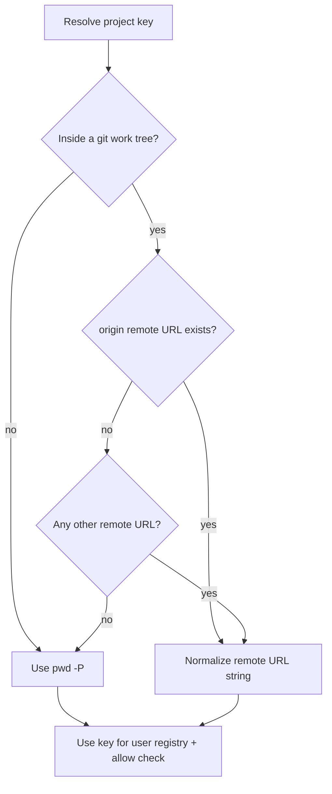

# Generic shell aliprehook system

## Goal

A **generic** wrapper so any opt-in command can run optional prehooks based on where you are. Project identity prefers **git remote** (portable across clone paths), then falls back to `$PWD`. Commands that do not opt in stay normal aliases/functions. `Dup` (docker compose up) is only one example consumer.

Config is split into two layers:

- **User layer** — your personal shortcuts and hooks under `~/.config/aliprehook/`
- **Project layer** — optional in-repo suggestions (e.g. `.aliprehook.yml`), **off until allowed**

## Naming

- System name: **aliprehook**
- User config dir: `~/.config/aliprehook/`
- Opt-in helper: `aliprehook_define`
- Runtime lookup: `aliprehook_run` (internal)
- Allow project layer: `aliprehook allow` / `aliprehook revoke` (direnv-style)

Daily use stays the **command name** you define (`Dup`, `serve`, …), not typing `aliprehook` every time.

## Config layers

Two different places config can live — owned by different people:

| Layer | Where it lives | Who writes it | Purpose |
|---|---|---|---|
| **User layer** | `~/.config/aliprehook/` | You | *Your* commands (`Dup`), *your* registry, *your* hooks |
| **Project layer** (optional) | Inside the git repo, e.g. `.aliprehook.yml` (+ optional scripts) | You or the team | Prep for *this* project (“before compose, copy `.env.example`”) |

**Why both?**

- Personal `Dup` should not be forced into every company repo.
- Project tips should not require every developer to hand-edit `~/.config`.
- **Security:** cloning a repo must not silently run project hooks. Project layer is **off until `aliprehook allow`**.

**Run order when you type `Dup --watch`:**

```text
You type: Dup --watch
    │
    ├─ 1) User layer: registry hook for (project key, Dup)? → run if any
    ├─ 2) Project layer: only if this repo was allowed → hook from .aliprehook.yml for Dup?
    └─ 3) docker compose up --watch
```

If a hook exits non-zero, abort before the next step / main command.

### Allow list (project layer gate)

Allowed repos are recorded under the user layer, e.g.:

```text
~/.config/aliprehook/allowed
# one normalized project key per line
github.com/org/sample_app_web
```

- `aliprehook allow` — add current project key to `allowed`
- `aliprehook revoke` — remove it
- No entry → skip project layer entirely (user layer still runs)

## Layout

### User layer

```text
~/.config/aliprehook/
  README.md            # how it works, setup, layers, allow, how to add a hook
  lib.zsh              # sourced from ~/.zshrc
  registry             # user lookup table: project_key + command → hook
  allowed              # project keys that may run project-layer hooks
  hooks/               # user prehook scripts
    example_echo.sh    # initial example (safe; prints project key + cmd)
    sample_app_web_Dup.sh
```

### Project layer (in a repo)

```text
<repo>/
  .aliprehook.yml     # declares command → hook (relative paths)
  .aliprehook/        # optional scripts referenced by the yml
    before_Dup.sh
```

Example `.aliprehook.yml`:

```yaml
# Only used after: aliprehook allow
hooks:
  Dup: .aliprehook/before_Dup.sh
  serve: .aliprehook/before_serve.sh
```

### README.md (required in user layer)

Ships with the install so anyone opening `~/.config/aliprehook/` can learn the system. Cover:

1. **What aliprehook is** — optional prehooks; user + project layers
2. **Setup** — `source` lib in `~/.zshrc`, then `aliprehook_define …`
3. **Project key order** — origin → first remote → PWD + normalization
4. **User registry** — three columns; commented examples
5. **Project layer + allow** — `.aliprehook.yml`, `aliprehook allow` / `revoke`
6. **How to add a user hook** — copy `example_echo.sh`, register, reload
7. **Try the example** — register current repo to `example_echo.sh`, run, see echo

### Initial example hook (user layer)

`hooks/example_echo.sh` is safe (no docker, no side effects): print that aliprehook ran, print project key and command name, exit 0.

`registry` ships with a **commented** example line pointing at it.

## How the project key is resolved

When you run an opt-in command, aliprehook picks a **project key** in this order:

1. **`origin` remote** — if `git remote get-url origin` succeeds
2. **Else first remote** — first URL from `git remote -v` (fetch)
3. **Else `$PWD`** — `pwd -P`

For steps 1–2, the remote URL is **normalized** before lookup/compare. User `registry` and `allowed` store the **normalized** form.



### Remote URL normalization

| Raw remote | After normalize (example) |
|---|---|
| `git@github.com:org/sample_app_web.git` | `github.com/org/sample_app_web` |
| `https://github.com/org/sample_app_web.git` | `github.com/org/sample_app_web` |
| `https://github.com/org/sample_app_web` | `github.com/org/sample_app_web` |
| `ssh://git@github.com/org/sample_app_web.git` | `github.com/org/sample_app_web` |

Rules (in `lib.zsh`):

- Strip `https://`, `http://`, `ssh://`, and `git@` / userinfo
- Turn `host:org/repo` (SCP-style) into `host/org/repo`
- Drop trailing `.git` and trailing `/`
- Lowercase host

## User registry

Plain text file under the user layer. Answers:

> “When I am in **this project** and I run **this command**, which **user** hook should run first?”

| Column | Meaning | Example |
|---|---|---|
| 1. Project key | Normalized remote, or path fallback | `github.com/org/sample_app_web` |
| 2. Command name | Which alias/function | `Dup` |
| 3. Hook script | Path under user `hooks/` | `hooks/sample_app_web_Dup.sh` |

### Example user `registry`

```text
# project_key  command  hook_relative_path

github.com/org/sample_app_web  Dup hooks/sample_app_web_Dup.sh
github.com/org/sample_app_api  Dup hooks/sample_app_api_Dup.sh
github.com/org/sample_app_web  serve hooks/sample_app_web_serve.sh

# Fallback: no remotes — key is absolute path
# /Users/me/scratch/local-compose-playground  Dup hooks/scratch_Dup.sh
```

| You are here | You type | What runs |
|---|---|---|
| Any clone of `sample_app_web` | `Dup --watch` | user hook (if any) → project hook if allowed → `docker compose up --watch` |
| Same, but project not allowed | `Dup` | user hook only → main command |
| Other project, no user line, not allowed | `Dup` | main command only |

```bash
git remote get-url origin  # preferred
git remote -v              # else first fetch URL
```

## How opt-in works

In `~/.zshrc`:

```bash
source ~/.config/aliprehook/lib.zsh

aliprehook_define Dup docker compose up
aliprehook_define serve pnpm dev

alias ll='ls -la'   # no aliprehook
```

`aliprehook_define Dup docker compose up` creates a **shell function** (not an alias):

```bash
Dup() {
  aliprehook_run Dup || return $?  # user layer then project layer
  docker compose up "$@"
}
```

- Opt-in commands use `aliprehook_define` (or Case B + `aliprehook_run`).
- Plain aliases stay fine when no prehook is needed.

What `aliprehook_run Dup` does each call:

1. Resolve project key (origin → first remote → PWD, normalized)
2. **User layer:** lookup `(key, Dup)` in `~/.config/aliprehook/registry` → run hook if any
3. **Project layer:** if `key` is in `allowed` and `.aliprehook.yml` maps `Dup` → run that hook
4. Return; caller then runs the main command

```mermaid
flowchart TD
  call["User runs cmd with args"]
  opt{"Defined via aliprehook_define or aliprehook_run?"}
  key["Resolve key: origin / first remote / PWD"]
  user{"User registry match?"}
  userHook["Run user hook"]
  allow{"Project key in allowed?"}
  proj{"Project yml maps cmd?"}
  projHook["Run project hook"]
  main["Run underlying command"]
  plain["Normal alias or function"]

  call --> opt
  opt -->|no| plain
  opt -->|yes| key --> user
  user -->|yes| userHook --> allow
  user -->|no| allow
  allow -->|yes| proj
  allow -->|no| main
  proj -->|yes| projHook --> main
  proj -->|no| main
```

## lib.zsh responsibilities

- `aliprehook_normalize_remote <url>`
- `aliprehook_project_key` — origin → first remote → `pwd -P`, remotes normalized
- `aliprehook_run <cmd_name>` — user hook then (if allowed) project hook
- `aliprehook_define <name> <command...>` — function wrapper around `aliprehook_run` + command
- `aliprehook allow` / `aliprehook revoke` — manage `allowed` for current project key
- Optional later: `aliprehook explain <cmd>` — print what would run

## Adding hooks

### User layer

1. Write `~/.config/aliprehook/hooks/<name>.sh`, `chmod +x`
2. Add a `registry` line: normalized key, command, hook path
3. Command must use `aliprehook_define` or call `aliprehook_run`

### Project layer

1. Add `.aliprehook.yml` (and scripts under `.aliprehook/` if needed) in the repo
2. From that repo: `aliprehook allow`
3. Same opt-in command names (`Dup`, etc.) as in the yml keys

No user registry line and no allowed project hook → command still runs normally.

## Converting an existing `.zshrc` function

### Case A — Mostly “do stuff, then one command”

Move prep into a **user** (or project) hook; use `aliprehook_define`.

### Case B — Real logic (branches, many steps)

Keep the function; call `aliprehook_run` at the top (runs both layers):

```bash
Dclear() {
  aliprehook_run Dclear || return $?
  # existing logic…
}
```

### Case C — Mix

Same as B: `aliprehook_run` first, then your logic.

| Situation | Use |
|---|---|
| Optional prehook + one underlying command | `aliprehook_define Name cmd…` |
| Function with its own logic | Keep function + `aliprehook_run Name` at top |
| No prehook needed | Normal function/alias |

## Out of scope (for now)

- Changing sample_app_web Docker/Make as part of this work
- Matching by folder basename only
- Preferring `upstream` over `origin` for forks (can add later)
- Signed/shared remote hook packs / marketplace (see as-a-tool doc)

## Implementation checklist

1. Create user layer: `~/.config/aliprehook/{README.md,lib.zsh,registry,allowed,hooks/}`
2. Write `README.md` covering setup, key resolution, both layers, allow, example hook
3. Implement normalize, project key, user registry lookup, project yml lookup, allow/revoke, `aliprehook_run`, `aliprehook_define`
4. Add `hooks/example_echo.sh` + commented user registry line
5. Document example `.aliprehook.yml` in README (optional stub in a personal test repo)
6. Wire `source` + `aliprehook_define Dup docker compose up` into `~/.zshrc`
